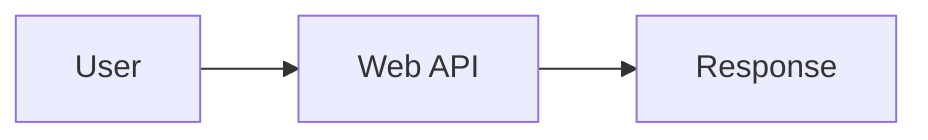

# Feature Guide

This document describes the main authoring features provided by `marp-theme-tmu-cs`.

For day-to-day rendering from another project, the intended entrypoint is the packaged `marp-tmu-cs` wrapper. It supplies the bundled engine and theme CSS automatically unless you override them explicitly.

## Engine Defaults

The custom engine extends normal Marp rendering with document-level defaults.

- it generates a title slide from non-empty title metadata
- it can add default `header` and `footer` values when they are omitted
- it can insert automatic section pages
- it can expand explicit TOC slides
- it resolves external code before rendering
- it processes citations before slide rendering
- it expands step-based code slides before final rendering

Typical front matter:

```yaml
---
marp: true
theme: tmu-cs
paginate: true
math: mathjax
title: TMU-CS
subtitle: Marp slides with annotations
author: Your Name
affiliation: Tokyo Metropolitan University
date: 2026-04-20
bibliography: references.bib
---
```

If `header` is not set, the engine builds one from `title / subtitle`. If `footer` is not set, the engine builds one from `author / date`.

A non-empty `title` generates a title slide unless `titleSlide: false` is set, the first slide already has the `title-slide` class, or the first slide already matches the title metadata.

## Section Pages And TOC Slides

The engine provides deck-structure features beyond standard Marp directives.

Front matter:

```yaml
---
sectionPages: true
sectionPageLevel: 2
tocPageMaxLevel: 2
---
```

Commands:

```md
# Table of contents

<!-- toc -->

---

# Deep TOC Example

<!-- toc level=3 -->
```

Behavior:

- `sectionPages: true` inserts auxiliary section pages automatically
- `sectionPageLevel` chooses which heading level is treated as a section boundary
- section headings used for automatic section pages are absorbed into the section page instead of being left behind as a duplicate heading-only slide
- `tocPageMaxLevel` sets the maximum heading level included by `<!-- toc -->`; it defaults to `sectionPageLevel`
- `<!-- toc level=N -->` overrides the maximum included heading level for one TOC slide
- a TOC before the first section covers the deck, while a TOC in or after a section covers only that section
- headings that use the `<!--fit-->` large-type pattern are excluded from generated TOCs
- section pages and TOC pages hide header, footer, and pagination; Marpit’s `paginate: skip` excludes them from the page count
- normal slides show the current section at top-left and pagination at top-right

Set `sectionPages: false` to disable automatic chapter pages. To override that
deck-wide choice for one chapter, place a standalone directive immediately
after its section heading (blank lines are allowed):

```md
## Selected chapter
<!-- section-page: true -->

### First content slide
```

Use `<!-- section-page: false -->` to omit an automatic chapter page when the
deck default is enabled. These switches control generated chapter pages;
authored Markdown headings and explicitly separated slides remain authored
content. Generated chapter pages hide header, footer, and pagination and do
not contribute to the visible page total.

TOC links use the heading IDs generated by Marp Core, including duplicate suffixes and custom `slug` options. A heading repeated by code-step expansion links to its first state.

Normal slides respect Marp’s `paginate: false`, `skip`, and `hold` directives. The generated title slide hides its number but remains counted by default.

## Edit IDs And A Slide Index

Give an authored slide a stable ID with a standalone comment:

```md
<!-- slide-id: tracking-result -->
### Tracking result
```

IDs start with a letter and use letters, digits, underscores, or hyphens.
Duplicate IDs are rejected. Reordering slides preserves explicit IDs; generated
chapter pages and code states keep their source ID and receive unique physical
IDs. IDs are metadata and do not replace Marp heading anchors or TOC links.

```sh
npx marp-tmu-cs --standalone --edit-labels --slide-index dist/slide-index.json slides.md -o dist/slides.html
```

The version-1 index contains `sourcePath` and `slides`. Each slide records `id`,
`sourceId`, `sourceLine`, `sourceSlide`, `physicalPage`, `number`, `total`, `kind`,
`state`, `title`, and `section`. Source lines refer to the start of the original
authored slide. Generated title/bibliography pages have no original source line.
Use explicit IDs when stability across reordering matters.

Edit labels are hidden by default. Enable them with `--edit-labels` or front
matter `editLabels: true`; they are omitted for PDF output and hidden in print.
Programmatic engine users can read the same index from `marp.tmuCsSlides` after
rendering. `--slide-index` accepts one explicit Markdown input.

## Annotated And Step-Emphasized Code

The theme uses Marp Core's Shiki renderer and language support for fenced code
blocks. Core's native fence metadata such as `python {2,4-5}` highlights logical
source lines, including lines loaded through `path` or `src`. Unknown languages
are rendered as plain text. The package adds notation transformers through
`marp.shikiTransformers`, then wraps long lines while preserving their emphasis.
Syntax colors are configured with `--marp-shiki-*` theme variables.

The package-specific magic-comment flow is step-based emphasis on languages
that have a supported line comment prefix.

Supported line comment prefixes:

- `//`: `c`, `cpp`, `csharp`, `fsharp`, `go`, `java`, `javascript`, `jsx`, `kotlin`, `php`, `rust`, `scala`, `swift`, `typescript`, `tsx`
- `#`: `perl`, `python`, `r`, `ruby`, `shell`, `toml`, `yaml`
- `--`: `lua`, `sql`

### Step-Emphasized Code With `step`

Use the language's supported line comment prefix plus `[!step ...]` to create slide-by-slide emphasis variants.

```cpp
for (int i = 0; i < 10; i++) {  // [!step 1 warning]
  std::cout << i << '\n';       // [!step 2 info]
}
return 0;                       // [!step 3 focus]
```

```python
for i in range(10):   # [!step 1 warning]
    print(i)          # [!step 2 info]
return_value = 0      # [!step 3 focus]
```

Visible comments may be kept before the directive:

```cpp
for (int i = 0; i < 10; i++) {  // loop counter [!step 1 warning]
  std::cout << i << '\n';       // output current value [!step 2 info]
}
```

Syntax:

```text
[!step <number> <highlight|focus|warning|error|info>[:N]]
```

Rules:

- step numbers must be positive integers
- supported actions are `highlight`, `focus`, `warning`, `error`, and `info`
- `:N` expands the effect to multiple code lines
- the directive must appear at the end of the comment; any comment text before it remains visible
- the engine emits one unhighlighted baseline slide and one slide per distinct step number
- step states are non-cumulative; equal step numbers are grouped, and missing numbers are allowed
- languages without a supported line comment prefix still get Shiki syntax highlighting, but `step` directives are ignored

## External Code Inclusion

Standalone Markdown links can be expanded into fenced code blocks automatically when the language can be inferred from the file extension.

```md
[sample.cpp](cpp/sample.cpp)
```

Notes:

- the link must occupy the whole line
- language can be inferred from the file extension
- the engine also supports fenced blocks with `path=` or `src=` attributes
- fenced external code blocks do not need an explicit fence language when the file extension is known
- an external-code fence must have an empty body; body content is ignored with a warning
- add `fit-height="true"` to a fenced block when the rendered code should be scaled to the remaining slide height
- external paths are confined to the directory containing the Markdown input after symbolic links are resolved
- pass Marp's `--allow-local-files` only for trusted input when an external-code path must leave that directory

## Diagrams

Diagram languages can be written as normal fenced code blocks without raw HTML.
`mermaid` uses Marp Core's native SVG renderer first. Diagrams unsupported by
the native renderer, or ones that raise a rendering error, fall back to Kroki.
Use `mermaid-kroki` to request the Kroki renderer explicitly when its rendering
or Mermaid compatibility is required.

Mermaid example:

````md

````

Other supported fence languages include `plantuml`, `graphviz`, `dot`, `vega`, `vegalite`, `nomnoml`, and the other Kroki languages listed in `src/features/diagrams/languages.mjs`.

Behavior:

- native Mermaid produces inline SVG during the build; no Kroki request is needed
- other diagram languages and Mermaid fallback use `https://kroki.io/` SVG images
- native diagrams use Core's sizing rules; Kroki images use Marp auto-scaling
- no raw HTML is required in Markdown source
- standalone HTML embeds native SVG font dependencies and fetches Kroki images during build, rewriting them to `data:` URLs
- native diagrams are available to HTML, PDF, and PPTX renderers; Kroki images in non-standalone output still require network access
- Core warns before falling back; invalid fallback syntax or Kroki availability problems surface as missing images, or as a standalone build failure

## Media Enhancements

GIF images are wrapped by the custom engine so they do not autoplay by default in HTML output.

- the slide initially shows a still poster frame
- playback starts only after the viewer presses the play button
- once started, the GIF is swapped in as a normal image element

This applies to standard Markdown image syntax when the image source ends with `.gif`.

### Sequential media playback

Enable ordered media steps for the deck in front matter:

```yaml
---
mediaPlayback: sequential
---
```

Enable or disable it on one slide with a local directive:

```md
<!-- _mediaPlayback: sequential -->
```

Use `off` to override a deck-wide setting. In interactive HTML, controls behave as follows:

- Right or the next button pauses media already playing on the slide, then selects the next GIF, native audio/video, or spectrogram audio in document order.
- Left or the previous button resets the preceding media step.
- Up and Down bypass media steps and retain Marp's normal fragment and slide navigation.

Manual media controls and Up/Down navigation do not move the sequence position. Leaving the slide resets the position and all media on that slide.

See [Sequential Media Playback](media-playback.md) for the complete contract and an example.

Audio elements can also opt into a wavegram spectrogram view by adding the `wavesurfer-spectrogram` class.

```html
<audio
  class="wavesurfer-spectrogram"
  controls
  src="../assets/sine-440hz.wav"
  data-spectrogram-height="120"
  data-spectrogram-fft-samples="2048"
></audio>
```

Behavior:

- the original `audio` source remains in the slide, but native browser controls are hidden in favor of `wavegram-player`
- the engine wraps it with a green theme frame and a `wavegram-player` Web Component after HTML rendering
- the wavegram runtime is embedded only when this class is present
- playback, seeking, cursor display, waveform rendering, spectrogram rendering, ready state, and time display follow wavegram defaults
- `data-spectrogram-height` and `data-spectrogram-fft-samples` are passed through as `spectrogram-height` and `fft-size` when explicitly present
- the spectrogram color map defaults to `magma`; `data-wavegram-color-map` can select another supported wavegram palette
- wavegram settings are applied before the audio source is loaded. The supported `data-wavegram-*` suffixes are `height`, `waveform-height`, `spectrogram-height`, `fft-size`, `hop-size`, `window-type`, `min-db`, `max-db`, `color-map`, `channel`, `show-waveform`, `show-spectrogram`, `show-controls`, and `show-time`. Explicit `data-wavegram-*` values take precedence over the two legacy aliases above
- in interactive slides, audio analysis starts when its slide becomes visible. Leaving the slide pauses playback and suspends drawing while retaining the player and its canvases for revisits
- normal and presenter views follow their active slide, next-page previews follow their own active slide, and overview thumbnails load as they enter the viewport. Plain HTML uses viewport visibility as well
- the retained native `audio` uses `preload="none"`; playback and analysis are handled by wavegram
- local spectrogram audio sources are converted to `data:` URLs during HTML rendering so they still work when the deck is opened directly from disk
- local audio resolution is exact and relative to the Markdown file; a missing path is reported and is never replaced by a same-basename file elsewhere
- remote audio sources need CORS headers that allow the browser-side analysis fetch

### Labelled audio rows and downloads

Add `data-audio-label` to an enhanced audio element to select the theme's audio
row layout. `data-audio-download` adds a download icon at the left and supplies
the suggested file name. Wrap several elements in `.tmu-cs-audio-list` to stack
channels with consistent spacing:

```html
<div class="tmu-cs-audio-list">
  <audio class="wavesurfer-spectrogram" src="audio/output-0.wav"
    data-audio-label="S0" data-audio-download="output-0.wav"
    data-wavegram-show-waveform="false"
    data-wavegram-show-controls="false" data-wavegram-show-time="false"
    data-wavegram-spectrogram-height="120"></audio>
</div>
```

The download link is connected when the visible player initializes and uses
the same original or embedded audio source as playback. Adding a download does
not embed a second copy of the audio payload. `--tmu-cs-audio-label-width`
adjusts the label column. Keep channel order and analysis settings in the deck.

## Standalone HTML Asset Bundling

When you build through the packaged `marp-tmu-cs` wrapper with `--standalone`, the engine rewrites local asset references so the output HTML can be shared as a single file.

Typical command:

```bash
npx marp-tmu-cs --standalone slides.md -o slides.html
```

Behavior:

- local and remote `img`, `audio`, `video`, and `source` assets are converted to `data:` URLs
- Kroki-hosted SVG diagram images are fetched during build and converted to `data:` URLs
- local GIF player sources are converted to `data:` URLs after GIF wrapping
- local HTML `iframe` sources are converted to `srcdoc`, and their local scripts, stylesheets, and media references are inlined recursively
- stylesheet `url(...)` references, including fonts, are embedded relative to the stylesheet
- local asset reads are confined to the Markdown input directory after resolving symbolic links; trusted decks may opt out with `--allow-local-files`
- remote iframes and unsupported asset references are rejected because they cannot satisfy the single-file guarantee
- a fetch, read, redirect-limit, or embedding failure makes the build exit with an error
- `--standalone` is intended for HTML output only
- standalone builds may fetch authored remote URLs and embed executable scripts from local HTML iframes; use them only with trusted decks

## Math Highlighting And Math Annotations

Display math can be annotated line by line using `% [!math-annotate ...]` comments at the end of TeX lines.

```tex
$$
X_k % [!math-annotate note="The k-th frequency component"]
= \sum_{n=0}^{N-1} % [!math-annotate note="Summation over all samples"]
x_n % [!math-annotate note="Discrete-time signal" color="#1f77b4"]
$$
```

Requirements and behavior:

- `math: mathjax` must be enabled in front matter
- `note` is required
- `color` is optional and accepts three- or six-digit hexadecimal colors, with or without `#`
- the annotation must be placed at the end of the line it describes
- the engine wraps the math block and injects a runtime that places note boxes and connectors

## Bibliography And Citation Management

The bibliography pipeline is built around the theme's citation syntax plus a BibTeX bibliography file. It is processed entirely in JavaScript using Citation.js and citeproc.

Citation example:

```md
This is a citation [@postel1981ip; @stroustrup2022tour].
```

Front matter:

```yaml
---
bibliography: references.bib
# csl: path/to/style.csl
citationDisplay: both
---
```

Behavior:

- `bibliography:` is required when citation syntax is used
- `csl:` is optional; otherwise the bundled IEEE CSL is used
- cited items are rendered into a footnote-style area on each slide
- Markdown footnotes are merged into the same visual region and share one numbering sequence with citations in first-occurrence order on each slide
- each Markdown footnote definition must be on the same slide as its reference
- citation-like text inside fenced code, inline code, HTML comments, links, and images is left unchanged
- a References slide is populated in place when the slide contains a `::: {#refs}` placeholder
- an otherwise empty `# References` slide is also populated in place
- if no references slide is present, the engine appends one when needed
- DOI and URL metadata are turned into links in bibliography entries

`citationDisplay` selects where citation entries appear:

| Value | Per-slide citation footnotes | Final bibliography |
| --- | --- | --- |
| `footnotes` | Yes | No |
| `bibliography` | No | Yes |
| `both` (default) | Yes | Yes |

In `bibliography` mode, numeric inline citations refer to the final bibliography
across the deck. In the other modes, citation numbers share the slide-local
sequence with Markdown footnotes. Authored Markdown footnotes remain visible in
all three modes. In `footnotes` mode, an otherwise empty reference heading or
references placeholder does not leave an empty slide behind.

Bibliography and CSL paths are resolved relative to the Markdown file but are not covered by the external-code root-confinement check. Render only trusted decks.

To control the insertion point explicitly, write a references slide like this:

```md
# References

::: {#refs}
:::
```

No external citation tool is required.
