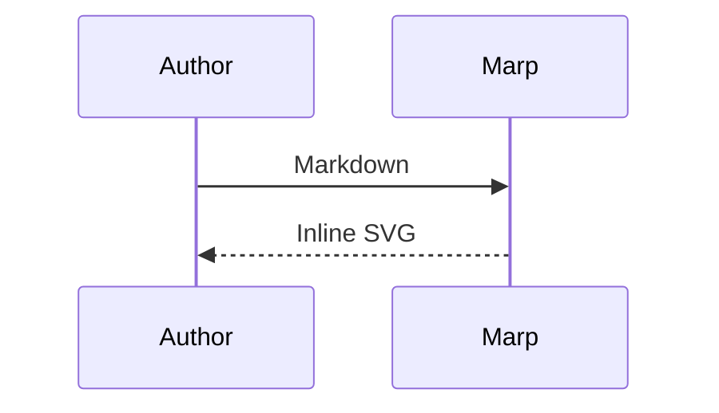
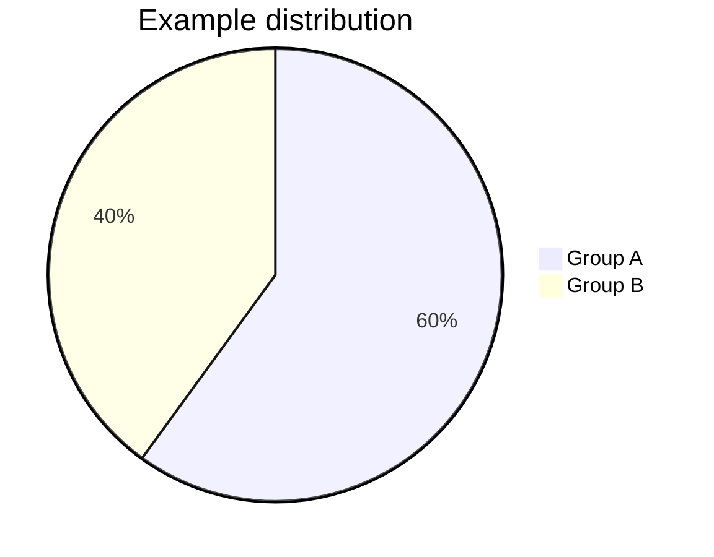
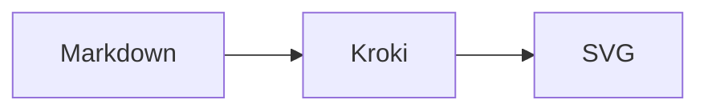

# Native line highlighting

Core highlights logical lines before the theme wraps them.

```cpp {2,4-5}
int first = 1;
const char* message = "A long source line keeps its highlight on every wrapped visual segment without changing the source file or its logical line numbers.";

int second = 2;
int total = first + second;
```

---

# Additional languages

Core loads the grammar when it is used.

```powershell
$names = @("Alice", "Bob")
foreach ($name in $names) {
    Write-Host "Hello, $name"
}
```

---

# Native Mermaid



---

# Automatic Mermaid fallback

Pie charts use Kroki when the native renderer does not support them.



---

# Explicit Kroki selection

Use `mermaid-kroki` to retain Kroki's rendering.



---

# Math inside annotation notes

$$
f(x) % [!math-annotate note="Map $\mathbb{R} \to \mathbb{R}$"]
= x^2 % [!math-annotate note="For example, $f(2)=4$"]
$$

Both the equation and the note math use the deck's MathJax renderer.
